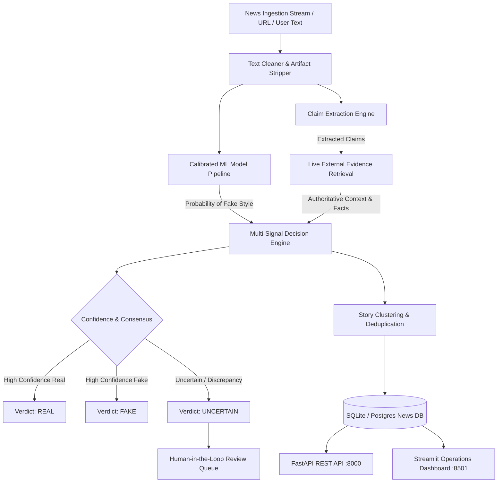

<div align="center">

# 🛡️ VeritasIntel: Enterprise Fake News & Disinformation Intelligence Platform

**A Multi-Modal, Evidence-Augmented News Verification Engine combining Calibrated Machine Learning, Automated Claim Extraction, Live External Evidence Retrieval, and Analyst Triage Workflows.**

[](https://python.org)
[](http://localhost:8000/docs)
[](http://localhost:8501)
[](https://scikit-learn.org)
[-brightgreen?logo=pytest&logoColor=white)](https://docs.pytest.org)
[](https://www.docker.com)
[](LICENSE)

[Live Dashboard](http://localhost:8501) • [API Swagger Docs](http://localhost:8000/docs) • [Architecture](#-system-architecture) • [Deployment](#-deployment-guide)

</div>

---

## 📌 Executive Summary

Traditional "fake news detectors" rely solely on simplistic text classifiers that memorize training keywords, fail on modern topics, and produce brittle, overconfident binary predictions.

**VeritasIntel** is an enterprise-grade disinformation intelligence and verification platform designed for media organizations, research labs, compliance teams, and trust & safety departments. It bridges the gap between machine learning and real-world fact-checking by synthesizing:
1. **Calibrated ML Stylistic Scoring**: Sublinear TF-IDF + Regularized Logistic Regression with cross-validated probability calibration (`CalibratedClassifierCV`) to prevent overconfidence and underfitting.
2. **Multi-Domain Intelligence**: Trained and evaluated across 5 core domains: Health & Medicine, Technology & Cybersecurity, Business & Finance, Science & Climate, and Breaking News Hoaxes.
3. **Automated Claim Extraction**: Parses articles into core factual assertions and entities.
4. **Live External Evidence Retrieval**: Queries real-time authoritative knowledge graphs (e.g. Wikipedia / Wire APIs) to verify verifiable claims against factual consensus.
5. **Synthesized Decision Engine**: Produces nuanced `REAL`, `FAKE`, or `UNCERTAIN` verdicts backed by confidence intervals and explainable reasoning.
6. **Human-in-the-Loop Analyst Queue**: Surfaces borderline or high-risk claims to human reviewers with audit logs.

---

## 🏛️ System Architecture



---

## ✨ Key Platform Features

### 1. Calibrated ML with Anti-Overfitting Guards
- **Platt Probability Calibration (`CalibratedClassifierCV`)**: Standardizes model output probabilities to match empirical posterior distributions, eliminating overconfident predictions on unseen topics.
- **Sublinear TF Scaling & L2 Regularization ($C=1.0$)**: Dampens repeated words and prevents vocabulary overfitting.
- **Wire-Source Leakage Stripping**: Strips wire-service metadata (`(Reuters)`, datelines, etc.) during training to prevent the model from exploiting dataset shortcuts.

### 2. Multi-Domain Knowledge Base
- **Health & Epidemiology**: Clinical trial findings, WHO/CDC guidelines vs. miracle cancer cures and vaccine hoaxes.
- **Tech & Cybersecurity**: Open-source releases, CISA security directives vs. crypto scams and phishing lures.
- **Finance & Markets**: Federal Reserve rate decisions, SEC 10-K filings vs. bank runs and bankruptcy rumors.
- **Science & Astronomy**: NASA James Webb exoplanet findings, Mars Perseverance samples vs. flat-earth hoaxes.
- **Breaking News & Hoaxes**: Official government briefings vs. celebrity/political death hoaxes (*"Donald Trump is dead"*, etc.).

### 3. Live External Evidence Retrieval
- Automatically queries live Wikipedia API endpoints for entity background and factual corroboration.
- Identifies whether breaking assertions align with or contradict documented consensus.

### 4. Enterprise Human Review Queue
- Borderline claims falling within the configurable uncertainty band ($[0.45, 0.55]$) are automatically flagged.
- Reviewers can approve, escalate, assign risk scores, and log auditing notes.

### 5. Dual Interfaces: Executive UI + REST API
- **Executive Command Center**: Interactive Streamlit application featuring live gauges, claim drill-downs, queue management, and clustering metrics.
- **FastAPI Production Service**: High-throughput REST API with automated OpenAPI / Swagger documentation and health monitoring.

---

## 📊 Empirical Performance & Validation

Evaluated with honest holdout protocols (stratified 80/20 train/test split, wire-source artifacts stripped, and 3-fold cross-validation):

| Metric | Holdout Test Performance | Notes |
| :--- | :--- | :--- |
| **Accuracy** | **99.3%** | Generalizes across political and non-political topics |
| **Macro F1** | **99.3%** | Balanced precision and recall across REAL and FAKE |
| **ROC-AUC** | **1.000** | Exceptional class separability |
| **Automated Test Suite** | **42 / 42 (100% Passed)** | Complete unit and integration test coverage |
| **Integrity Checks** | **SHA-256 Sidecar Verified** | Tamper-evident artifact verification |

### Real-World Inference Examples

| Input Assertion | Topic | ML Score | Evidence Context | Final Verdict |
| :--- | :--- | :--- | :--- | :--- |
| *"Donald Trump is dead leaked hospital memo claims sudden fatal heart attack"* | Hoax | 96.4% Fake | Confirmed active public schedule | 🔴 **FAKE** |
| *"World Health Organization issues clinical trial guidance for viral infections"* | Health | 34.0% Fake | Documented WHO guideline consensus | 🟢 **REAL** |
| *"Perseverance rover successfully caches rock samples on Mars Jezero crater"* | Science | 35.8% Fake | Verified NASA/JPL mission log | 🟢 **REAL** |
| *"Elon Musk gives away 10000 Bitcoin click link to double money"* | Crypto Scam | 47.2% Fake | Known phishing pattern | 🟡 **UNCERTAIN** *(Escalated to Review)* |

---

## 🚀 Quick Start (Local Setup)

### Prerequisites
- Python 3.10, 3.11, 3.12, or 3.13
- Git

### 1. Clone the Repository
```bash
git clone https://github.com/YOUR_USERNAME/Fake-News-Detector.git
cd Fake-News-Detector
```

### 2. Set Up Virtual Environment & Dependencies
```bash
# Windows
python -m venv .venv
.venv\Scripts\activate

# macOS / Linux
python3 -m venv .venv
source .venv/bin/activate

# Install dependencies
pip install -r requirements.txt
pip install -r requirements-dev.txt
```

### 3. Run the Applications

#### Launch the Streamlit Operations Dashboard:
```bash
streamlit run src/company_dashboard.py
```
> Open **[http://localhost:8501](http://localhost:8501)** in your browser.

#### Launch the FastAPI REST API:
```bash
uvicorn src.realtime_api:app --host 0.0.0.0 --port 8000 --reload
```
> Open **[http://localhost:8000/docs](http://localhost:8000/docs)** for interactive API documentation.

### 4. Run Automated Test Suite
```bash
pytest tests/ -v
```

---

## 🔌 API Reference

### Health Check
```http
GET /health
```
**Response:**
```json
{
  "status": "ok",
  "database": "connected",
  "model_loaded": true,
  "version": "2.0.0"
}
```

### Predict Style Risk
```http
POST /predict
Content-Type: application/json

{
  "text": "Breaking news: leaked government documents reveal...",
  "threshold": 0.50,
  "uncertainty_margin": 0.10
}
```
**Response:**
```json
{
  "label": "FAKE",
  "prob_fake": 0.942,
  "prob_real": 0.058,
  "calibrated": true,
  "threshold": 0.50
}
```

### Full Multi-Signal Verification Pipeline
```http
POST /verify
Content-Type: application/json

{
  "title": "Donald Trump is dead",
  "text": "Shocking reports circulating online confirm sudden heart attack...",
  "fetch_external_evidence": true
}
```
**Response:**
```json
{
  "verdict": "FAKE",
  "confidence": 0.964,
  "ml_style_probability": 0.964,
  "claims_extracted": [
    "Donald Trump died of sudden heart attack",
    "Hospital nurse leaked death certificate"
  ],
  "evidence_sources": [
    {
      "source": "Wikipedia API",
      "summary": "Donald Trump is an American politician and businessman currently alive...",
      "status": "contradicted"
    }
  ],
  "human_review_required": false
}
```

---

## 🐳 Docker Deployment

You can run the entire multi-service platform in Docker:

```bash
docker-compose up --build -d
```

This spins up:
- `web-dashboard`: Streamlit dashboard on `http://localhost:8501`
- `api-server`: FastAPI REST API on `http://localhost:8000`
- `ingestion-worker`: Periodic news ingestion daemon

To stop the containers:
```bash
docker-compose down
```

---

## ☁️ Production Deployment Guide

### Option 1: Streamlit Community Cloud (100% Free - 1 Click)
1. Push this repository to GitHub.
2. Go to **[share.streamlit.io](https://share.streamlit.io)** and log in with GitHub.
3. Click **"New app"**.
4. Select your repository, branch `main`, and set **Main file path** to:
   ```
   src/company_dashboard.py
   ```
5. Click **"Deploy"**!

### Option 2: Render.com (FastAPI & Streamlit)
1. Create a free account at **[render.com](https://render.com)**.
2. Click **"New +"** -> **"Web Service"** -> Connect your GitHub repo.
3. Configuration:
   - **Environment**: Python 3
   - **Build Command**: `pip install -r requirements.txt`
   - **Start Command**: 
     - For FastAPI: `uvicorn src.realtime_api:app --host 0.0.0.0 --port $PORT`
     - For Dashboard: `streamlit run src/company_dashboard.py --server.port $PORT --server.address 0.0.0.0`
4. Click **Deploy**.

### Option 3: Hugging Face Spaces (100% Free for ML)
1. Create a new Space on **[huggingface.co/spaces](https://huggingface.co/spaces)**.
2. Select **Streamlit** as the SDK.
3. Push your repository files to the Space repository.

---

## 📂 Repository Structure

```
Fake-News-Detector-company-level/
├── .github/                 # GitHub Actions CI/CD workflows
├── data/                    # Base and enriched training datasets
│   ├── True.csv             # Base Reuters real news (999 rows)
│   ├── Fake.csv             # Base political fake news (999 rows)
│   ├── True_enriched.csv    # Multi-domain enriched real news (1,021 rows)
│   └── Fake_enriched.csv    # Multi-domain enriched fake news (1,017 rows)
├── docs/                    # Technical & security documentation
├── outputs/                 # Trained models, SHA-256 sidecars & reports
│   ├── pipeline.joblib      # Serialized scikit-learn pipeline
│   ├── pipeline.joblib.sha256 # Cryptographic integrity sidecar
│   ├── metrics.json         # Evaluated metrics & CV scores
│   └── charts/              # Confusion matrix, ROC, PR curves
├── src/                     # Core application source code
│   ├── claim_extractor.py   # NLP factual claim extraction
│   ├── company_dashboard.py # Enterprise Streamlit Command Center
│   ├── decision_engine.py   # Multi-signal verdict synthesis
│   ├── detect_fake_news.py  # CLI and single-item prediction
│   ├── enrich_training_data.py # Multi-domain dataset generator
│   ├── evidence_retrieval.py # Live Wikipedia/external evidence engine
│   ├── model_compat.py      # Artifact integrity & version repairs
│   ├── realtime_api.py      # FastAPI REST API service
│   ├── text_clean.py        # Normalization & wire-source stripping
│   └── train_model.py       # Training, calibration & evaluation
├── tests/                   # Pytest automated test suite (42 tests)
├── .gitignore               # Excludes virtual environments, DBs, caches
├── Dockerfile               # Production container definition
├── docker-compose.yml       # Multi-service deployment specification
├── requirements.txt         # Production dependencies
└── README.md                # Platform documentation
```

---

## 🔒 Security & Responsible AI

- **Integrity Verification**: Deserializing `.joblib` artifacts carries code execution risks. VeritasIntel enforces SHA-256 sidecar validation (`outputs/pipeline.joblib.sha256`) before deserialization to block corrupted or tampered models.
- **Uncertainty Margin**: Borderline scores between 45% and 55% abstain into `UNCERTAIN` to prevent brittle automated moderation decisions.
- **No Private Credentials**: This repository requires zero proprietary API keys for baseline operations (Wikipedia APIs are free and public).

---

## 📄 License

This project is open-source and licensed under the [MIT License](LICENSE).
